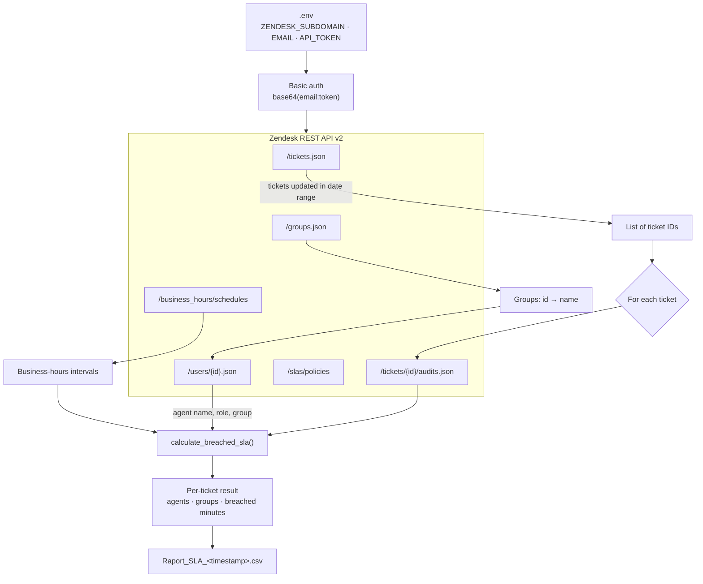
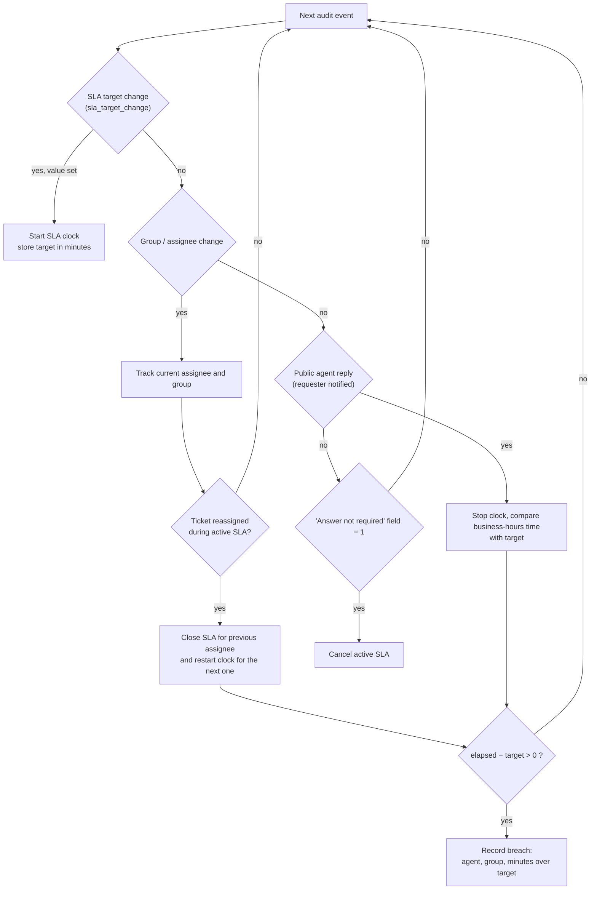

# slaRaport

A Python script that audits Zendesk tickets and produces a CSV report showing **which agents, in which tickets and from which groups breached the SLA, and by how much**.

The script fetches every ticket updated in a given date range, replays each ticket's audit log, measures the response time in **business hours** and compares it with the SLA target set by the Zendesk SLA policy.

## Features

- Fetches all tickets updated in a chosen date range
- Replays ticket audits (comments, assignee/group changes, SLA target changes)
- Counts time only within the company's Zendesk business-hours schedule (timezone `Europe/Warsaw`)
- Attributes each breach to the agent and group that owned the ticket at the time
- Handles ticket reassignment: SLA time is split between the previous and the next assignee
- Cancels the SLA when the ticket's "answer not required" field is set
- Exports a semicolon-separated CSV report (Polish column headers)

## How it works



### SLA calculation logic

The audit log of each ticket is processed chronologically:



Business-hours time is calculated by `dt_in_bh()`: it converts both timestamps to `Europe/Warsaw`, maps them onto a weekly minute scale (Zendesk's schedule model) and sums the overlap with the business-hours intervals day by day.

## Output

The report is saved as `Raport_SLA_<YYYY-MM-DDTHH-MM-SSZ>.csv` in the working directory. Delimiter: `;`.

| Column | Meaning |
|--------|---------|
| `Numer Ticketu` | Ticket ID |
| `Suma przekroczonych SLA [h]` | Total breached SLA time in hours |
| `Liczba przekroczonych SLA` | Number of breaches in the ticket |
| `Liczba odpowiedzi` | Number of public replies written by agents/admins |
| `Procent odpowiedzi w terminie` | `1 − breaches / replies`, in percent |
| `Imię i nazwisko #n` | Agent responsible for the n-th breach |
| `Grupa #n` | Agent's group |
| `Przekroczone SLA #n` | Minutes over the SLA target |

The three last columns repeat for every breach in the ticket (the number of repetitions equals the largest breach count among all tickets).

## Getting started

### Prerequisites

- Python 3.8+
- A Zendesk account with API access (token authentication enabled)

### Install

```bash
git clone https://github.com/GaussFighting/slaRaport.git
cd slaRaport
pip install requests python-dotenv pytz
```

### Configuration

Create a `.env` file (never commit it):

```
ZENDESK_SUBDOMAIN=your-company
EMAIL=agent@your-company.com/token
API_TOKEN=your_api_token
```

> Zendesk API-token authentication expects the username in the form `email/token`. 

Set the date range at the top of the script:

```python
updated_since = '2024-07-01T00:00:00Z'
updated_before = '2024-09-30T23:59:59Z'
```

### Run

```bash
python main.py  
```

Progress is printed to the console (`Progress: i / N`).

### Testing on a single ticket

In the script, comment out the "loop over tickets" block and uncomment the "TEST FOR SINGLE TICKET" block (set the ticket ID there).

## Rate limits

Audits are fetched one ticket at a time with a 0.3 s pause between requests to stay below the Zendesk limit (400 requests/min on the Professional plan). Large date ranges therefore take a while.

## Known limitations

- Date range is hard-coded in the script (no CLI arguments yet)
- Only the first business-hours schedule of the account is used
- User lookups are not cached, so the same agent may be fetched many times
- API errors are printed instead of raised
- `sla_duration()` is defined but not used; SLA targets are taken from `sla_target_change` events in the audit log

## Roadmap

- [ ] CLI arguments for the date range
- [ ] Split the script into modules (`api`, `business_hours`, `sla`, `report`)
- [ ] Cache user and group lookups
- [ ] Raise exceptions on API errors, skip a single failing page/ticket instead of aborting
- [ ] `requirements.txt` and tests for `dt_in_bh()`

## License

TODO
